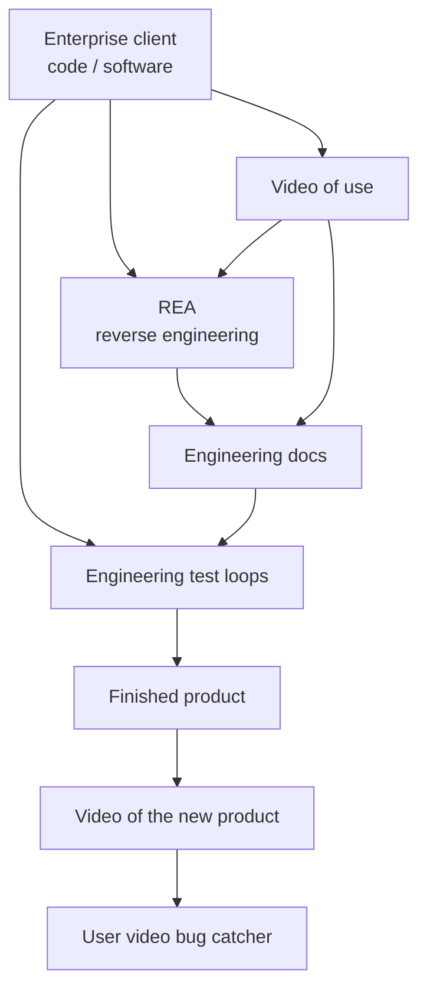
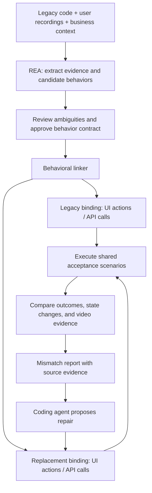

# Forward Deployed 8090

EVOLVE: 8090 AI Hackathon project by Anushka and Connor (Nov 13–14, 2026).

An agent pipeline that does a forward-deployed engineer's job on a legacy enterprise app. It takes the client's existing software and recordings of people using it, works out how the system really behaves, rebuilds it, and uses video to check that the new version does what the old one did.

**Current scope and decisions: [docs/DECISIONS.md](docs/DECISIONS.md).** Demo target: [fixtures/legacy-plant](fixtures/legacy-plant).

## How it works

1. **Inputs.** The client's existing code and software, plus screen recordings of real users working in it.
2. **Reverse engineering.** REA analyses the code and the recordings and writes engineering docs that describe how the system behaves in practice, not just what the code says.
3. **Build and test.** Agents work from the docs and the original code in test loops until the rebuilt app passes.
4. **Video check.** The finished product is recorded running the same flows, and the bug catcher compares that video against the original user video to flag any behaviour that changed.

## Proposed extension: portable behavior contracts and a behavioral linker

**Status: proposal for discussion; not implemented.** Keep the forward-deployed engineer pipeline as the product. Add the behavioral linker as the layer that makes a user's workflow portable between the legacy app and its replacement. Fusion—the idea of composing incompatible systems into a new business capability—becomes a future application of this layer, rather than a separate acquisition product we have to build alongside modernization.

> **Show us how your software is used. We turn that workflow into an executable contract, rebuild the software, and show which behaviors were preserved.**

### The primitive: a portable behavior contract

A recording captures what a user did in one interface. A behavior contract describes what must remain true when that workflow runs in another implementation. It connects:

- **Evidence:** timestamps in a recording, relevant code, and business documents supporting each observation or rule.
- **Intent and preconditions:** the user's goal, account role, starting state, and inputs.
- **Actions and outcomes:** business operations such as quoting or submitting an order, expected prices, and resulting records.
- **Failure behavior:** what should happen after a timeout, retry, cancellation, or partial failure.
- **Uncertainty and approval:** what was observed, what was inferred, which policies a person approved, and what remains unknown.

A recording alone cannot establish hidden side effects, permissions, or retry guarantees. Use code, instrumented execution, and approved policies to fill those gaps. Unknowns must stay explicit. Existing behavior can also be a bug: decide which behaviors to preserve and which to intentionally change before treating them as requirements.

### How the linker fits into our existing pipeline

The linker maps the same business operations onto each implementation. For example, the old app may quote in integer cents through an invoice form while the rebuilt app returns decimal dollars through a checkout API. Bindings reconcile those representations without changing the approved business meaning.

Some differences cannot be fixed with field mapping. If a workflow requires safe retries but the target API creates a new charge on every call and offers no way to reconcile requests, the linker should report the missing capability. An agent can then propose the needed implementation change; the system must not claim the contract is satisfied until it is tested.

The video bug catcher remains central. It supplies replay evidence and catches visible regressions, while the contract checks business outcomes that pixel similarity cannot establish. Verification should tolerate intentional layout changes and still detect a wrong price, missing confirmation, or duplicate charge.

### A short demo: rebuild the interface without losing the business

1. **0:00–0:40 — Show the original workflow.** A user places an order in a small legacy app. Their enterprise account receives a negotiated price. Show the original recording and the resulting order.
2. **0:40–1:20 — Extract and approve the contract.** Show evidence for the price rule and order confirmation. Add an explicitly approved retry-safety policy; do not pretend the video proved it. Highlight one ambiguity and resolve it.
3. **1:20–2:20 — Link the rebuilt app.** Replay the same business workflow through a visibly different interface. The replacement looks correct but loses the negotiated price. Show a failing assertion linked to the source evidence and the relevant code.
4. **2:20–3:30 — Repair and verify.** A coding agent proposes a real code change. Rerun the same preserved acceptance scenarios and show the correct price, actual diff, execution results, and replacement recording. Label any prerecorded run rather than presenting it as live generation.
5. **3:30–4:20 — Test a failure the video never showed.** Drop a response after an order commits, then retry. Check the underlying records to verify that only one order and charge exist. Show a failing version as well as the corrected one.
6. **4:20–5:00 — Show portability and the business value.** If implemented, bind the contract to a third interface or compose the order capability with shipping. Otherwise identify this as the next milestone. Close with measured results and what the team built during the event.

Use synthetic fixtures until we select a suitable real target. Keep the factory's generated artifacts separate from the applications used to demonstrate it. The product being judged is the factory; the rebuilt app is evidence of its output.

### Implementation sequence

1. **Choose the target and establish a baseline.** Select one legacy app and two or three workflows. Capture recordings, test data, and inspectable before/after state. Confirm REA access, capabilities, licensing, and any pre-existing-work restrictions before depending on it.
2. **Define the contract format.** Represent evidence references, actions, preconditions, expected outcomes, policies, and unknowns in a versioned schema. Review inferred rules before they become acceptance criteria.
3. **Build two bindings and one replay runner.** Start with explicit mappings to the legacy and replacement apps. Generate executable replay steps and normalize known differences such as money units. Verify one workflow end to end before automating discovery.
4. **Connect the video bug catcher.** Align recordings by semantic checkpoints rather than identical timestamps or pixels. Combine visible evidence with assertions over application state; retain source timestamps in mismatch reports.
5. **Connect the coding-agent repair loop.** Supply the contract, evidence, failed checks, and relevant code. Generate a reviewable patch and rerun verification. Preserve acceptance scenarios outside the builder's editable scope and version intentional policy changes explicitly.
6. **Automate contract and binding proposals.** Use REA and coding agents to propose mappings from code and recordings. Surface ambiguity, missing capabilities, and unsupported operations rather than fabricating a successful link.
7. **Prove reuse, then compose.** Apply the same contract to an unfamiliar third implementation. Only then extend toward Fusion-style workflows spanning multiple systems, including ordering, shipping, compensation, and partial failure.

### Testing and evidence

| Test | What it establishes |
| --- | --- |
| Known-good legacy and replacement flows | The contract executes against both implementations and checks expected outcomes. |
| Deliberately wrong price, missing confirmation, or wrong role | The verifier detects meaningful regressions instead of accepting visual similarity. |
| The same defect in both apps | Independent approved expectations catch shared bugs; matching outputs alone is insufficient. |
| Lost response followed by retry | Inspect durable state for duplicate orders and charges, not just a success message. |
| Different layouts, timing, labels, and money representations | Bindings preserve meaning without demanding identical pixels. |
| Missing capability or unresolved rule | The linker reports blocked or unknown rather than a false pass. |
| Changed contract or binding | Versioned evidence identifies exactly what was checked; stale results cannot stand in for a fresh run. |
| An unfamiliar third implementation | The contract and linker are reusable rather than hard-coded to one demonstration. |

Report scenarios passed, failed, and blocked; seeded defects caught and missed; false alarms; runtime; model cost; and human interventions. Distinguish executed checks from inferred conclusions. Passing a bounded scenario suite is evidence, not a proof of universal behavioral equivalence.

### Why add this, and where to stop

The original concept is already a strong product direction. This extension gives the rebuild-and-video-check loop a reusable interface: **an executable behavior contract that can survive a change of implementation**. That is the proposed primitive. Its novelty must be demonstrated through reuse and composition, not asserted from a new name; a broader prior-art review remains necessary before claiming it is unprecedented.

For EVOLVE, prioritize the recorded workflow, one real generated change, a caught regression, and verified recovery. This maps to technical execution, enterprise utility, creativity, and a clear demo. Do not let a separate merger dashboard, a generic orchestration platform, or extra sponsor integrations displace that working loop. The larger Fusion vision is a follow-on once portability is real.

## Original sketch

## Plan for the 20 hours

- **Keep the target small.** One small legacy app with two or three user flows. The video bug catcher is the part that has to work in the demo.
- **Headline number.** Report how many of the recorded user flows the rebuilt app reproduces (for example, 3 of 3 flows matched).
- **Software Factory.** Map the engineering docs to Requirements and Blueprints and the test loops to Work Orders, and push them in over MCP.
- **Sponsor tools.** ElevenLabs to narrate the usage and demo videos (it also has its own prize). HydraDB to store the engineering docs as agent memory.
- **Open question.** Confirm in #evolve-help that using REA, a tool built before the event, is allowed. It will be listed with its license below either way.

## Tools and licenses

The rules ask for every AI tool, library and API used to be listed here with its license. Add entries as they are used.

| Tool | Used for | License |
| --- | --- | --- |
| | | |

## Team resources

Planning docs and deadlines: [RESOURCES.md](RESOURCES.md).

## License

[MIT](LICENSE)
