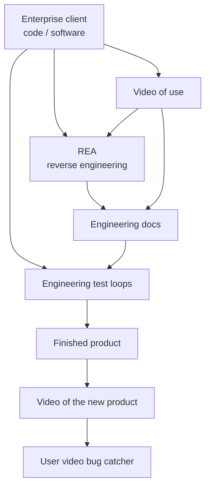
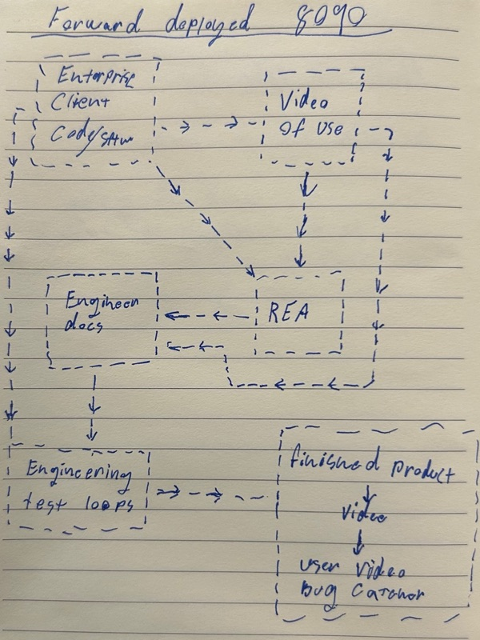

# Forward Deployed 8090

EVOLVE: 8090 AI Hackathon project by Anushka and Connor (Nov 13–14, 2026).

An agent pipeline that does a forward-deployed engineer's job on a legacy enterprise app. It takes the client's existing software and recordings of people using it, works out how the system really behaves, rebuilds it, and uses video to check that the new version does what the old one did.

## How it works

1. **Inputs.** The client's existing code and software, plus screen recordings of real users working in it.
2. **Reverse engineering.** REA analyses the code and the recordings and writes engineering docs that describe how the system behaves in practice, not just what the code says.
3. **Build and test.** Agents work from the docs and the original code in test loops until the rebuilt app passes.
4. **Video check.** The finished product is recorded running the same flows, and the bug catcher compares that video against the original user video to flag any behaviour that changed.

## Original sketch

## Plan for the 20 hours

- **Keep the target small.** One small legacy app with two or three user flows. The video bug catcher is the part that has to work in the demo.
- **Headline number.** Report how many of the recorded user flows the rebuilt app reproduces (for example, 3 of 3 flows matched).
- **Software Factory.** Map the engineering docs to Requirements and Blueprints and the test loops to Work Orders, and push them in over MCP.
- **Sponsor tools.** ElevenLabs to narrate the usage and demo videos (it also has its own prize). HydraDB to store the engineering docs as agent memory.
- **Open question.** Confirm in #evolve-help that using REA, a tool built before the event, is allowed. It will be listed with its license below either way.

## Tools and licenses

The rules ask for every AI tool, library and API used to be listed here with its license. Add entries as they are used.

| Tool | Used for | License |
| --- | --- | --- |
| | | |

## Team resources

Planning docs and deadlines: [RESOURCES.md](RESOURCES.md).

## License

[MIT](LICENSE)
